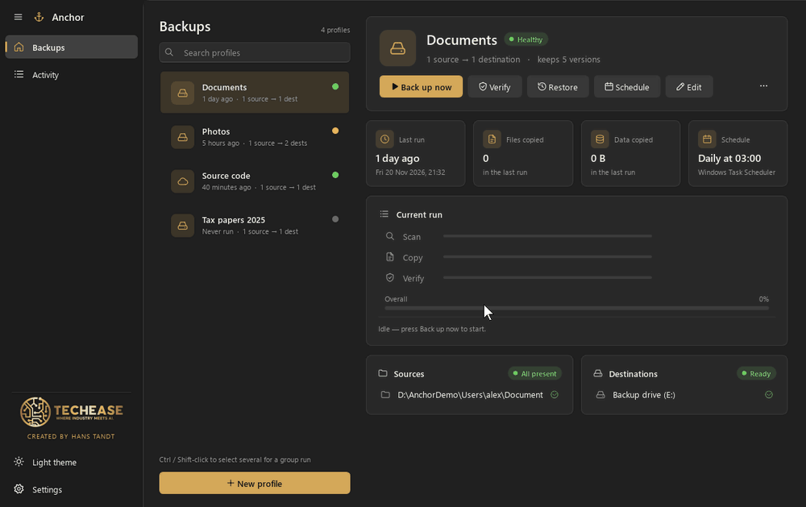
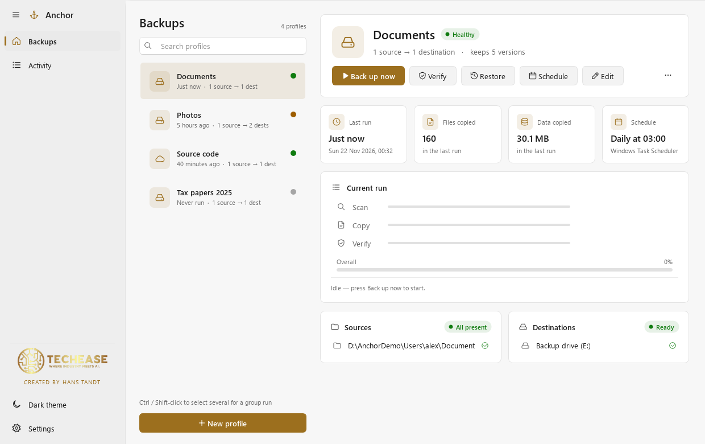
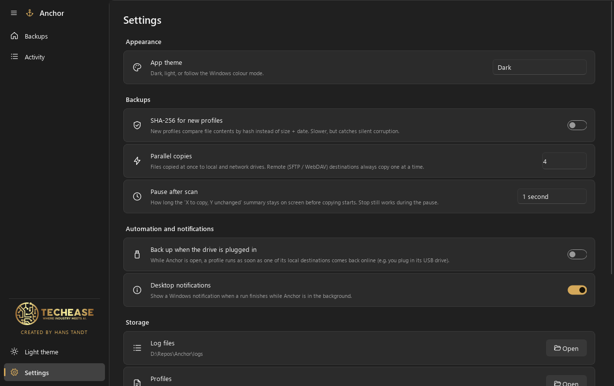

<p align="center">
  
</p>

<h1 align="center">Anchor</h1>

<p align="center">
  <em>Incremental backups for Windows 10 and 11 — set it up once, then forget it.</em>
</p>

<p align="center">
  <a href="https://github.com/Hans-Tandt/Anchor/actions/workflows/ci.yml"></a>
  <a href="https://github.com/Hans-Tandt/Anchor/releases/latest"></a>
  <a href="LICENSE"></a>
  
  
</p>

<p align="center">
  
</p>

Anchor copies the folders you choose to a USB drive, a network share, OneDrive, or a NAS over
SFTP / WebDAV. It only copies what changed, can keep older versions of every file, and checks
after each run that everything really arrived.

## Features

- **Incremental**: size + date (fast) or SHA-256 (thorough) change detection.
- **Safe writes**: every file goes to a temp file first and is then renamed into place.
- **Versioning**: keep the last *N* versions of each file, so a bad edit or ransomware can be undone.
- **Verify**: after copying, Anchor checks that every file is at the destination at the right size.
- **Restore**: browse a backup, pick a file and a version, and restore it to its original or another folder.
- **Mirror deletions** with a safety cap, so a missing drive never wipes your backup.
- **Schedules** through Windows Task Scheduler, **group runs**, **auto-run when a drive is plugged in**.
- **Secure remotes**: passwords live in Windows Credential Manager, SFTP host keys are pinned on first use, and TLS is verified.
- **Fluent UI** with dark, light or system theme, desktop notifications and a live activity log.

<p align="center">
  
  
</p>

More screenshots and a tour: **[docs/screenshots.md](docs/screenshots.md)**.

## Install

**Download** the latest `Anchor-x.y.z-Windows.zip` from
[Releases](https://github.com/Hans-Tandt/Anchor/releases/latest) (also on the
[project page](https://hanstandt.be/projects/anchor/)); its SHA-256 is in the release notes. Unzip
and run `Anchor.exe`. The build is not code-signed, so SmartScreen will ask once:
**More info → Run anyway**.

**Or run from source** (Python 3.10+):

```bat
git clone https://github.com/Hans-Tandt/Anchor.git
cd Anchor
install.bat
run.bat
```

`install.bat` runs `pip install -r requirements.txt`; `run.bat` starts `python -m anchor`.

## Documentation

| | |
|---|---|
| [User guide](docs/user-guide.md) | Profiles, destinations, schedules, restore, settings |
| [Security](docs/security.md) | Credentials, SFTP host keys, TLS, what Anchor stores where |
| [Architecture](docs/architecture.md) | How the engine, destinations and GUI fit together |
| [Development](docs/development.md) | Tests, building the exe, CI/CD and releases, regenerating images |
| [Changelog](CHANGELOG.md) · [Contributing](CONTRIBUTING.md) · [Security policy](SECURITY.md) | |

## Project layout

```
anchor/            the application package
  core/            engine, walker, state DB, run lock, profile model
  destinations/    local / SFTP / WebDAV adapters behind one interface
  gui/             PySide6 UI (pages/, Fluent widget kit, dialogs)
  resources/       app icon and brand logo bundled into the exe
  cli.py           headless runner used by scheduled tasks
  diagnose.py      python -m anchor.diagnose
docs/              documentation, screenshots, GIFs
packaging/         PyInstaller spec
scripts/           build.bat, icon / brand / demo generators
tests/             pytest suite (headless)
.github/           CI, release workflow, issue templates
```

## License

[MIT](LICENSE) © Hans Tandt. Created by Hans Tandt · TechEase.
