# Screenshots

All images are generated by [`scripts/record_demo.py`](../scripts/record_demo.py) from a sandbox
with demo data, so they always match the current UI.

## Running a backup

Scan, copy and verify, with live speed and ETA, the copy ring, and a notification at the end.

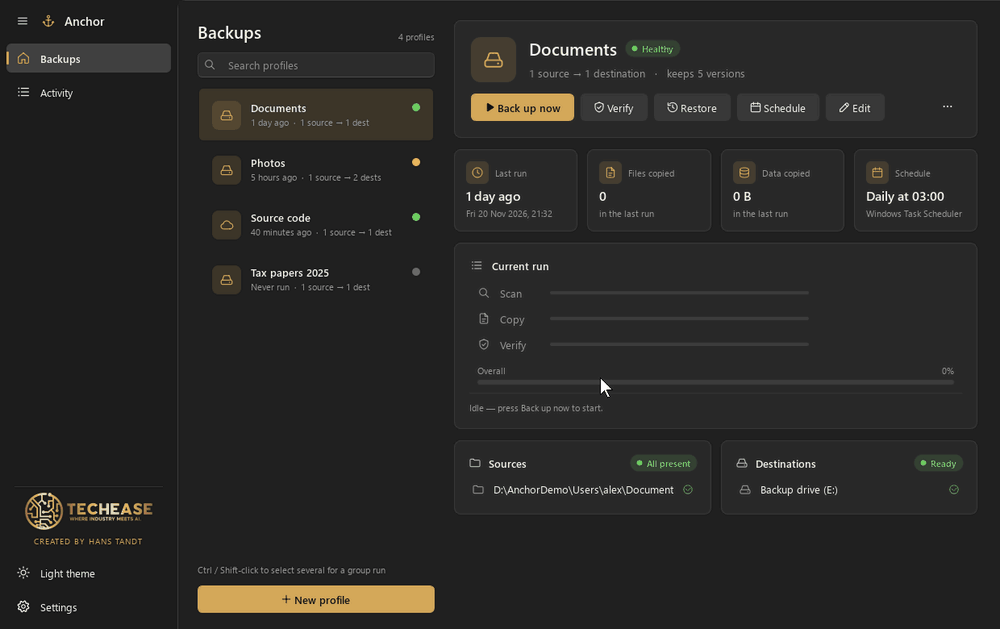

## Tour

Switching profiles, the Activity log, Settings, the dark/light theme toggle and the compact
navigation rail.

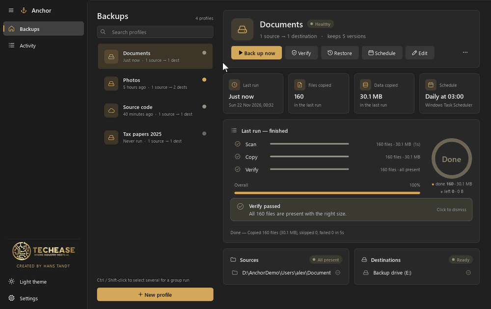

## Backups page

| Dark | Light |
|---|---|
|  | 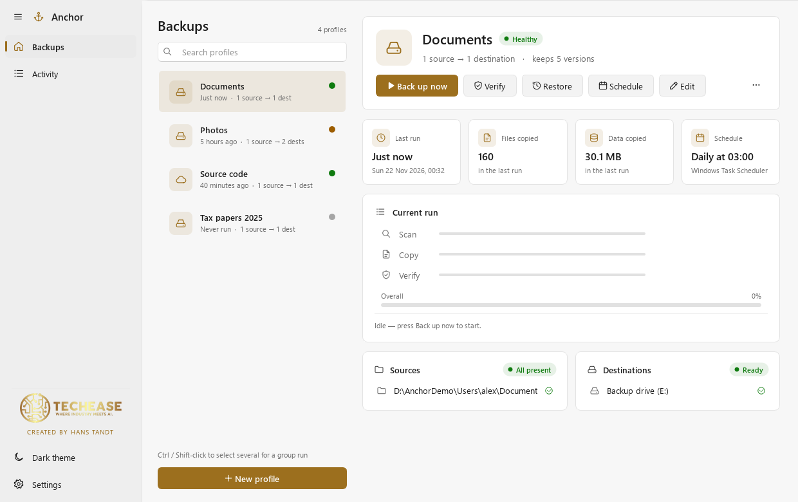 |

A finished run: every phase done, verify passed, the ring shows **Done**.

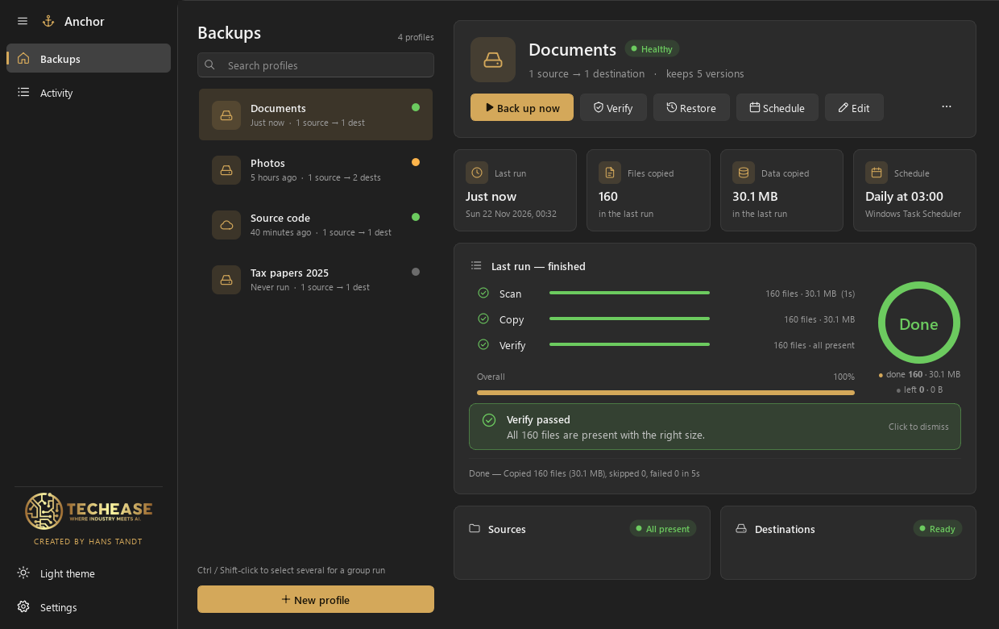

A profile with two destinations, one of them a remote NAS over SFTP:

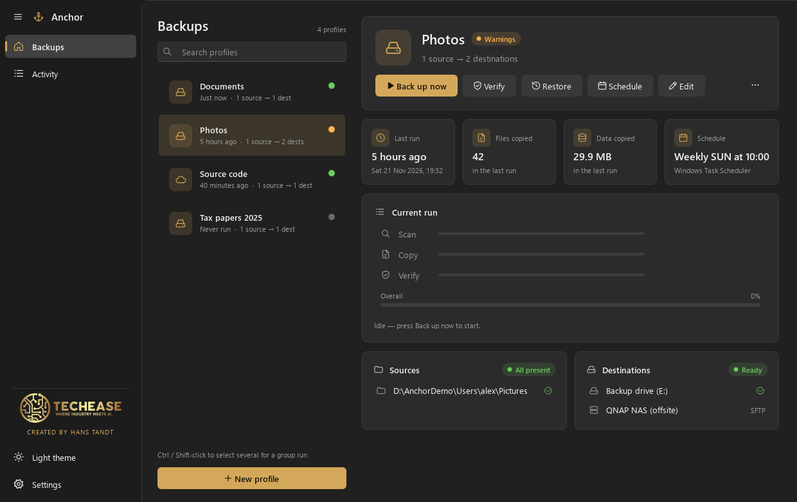

## Activity

The live log, colour-coded by level, with a level filter and search.

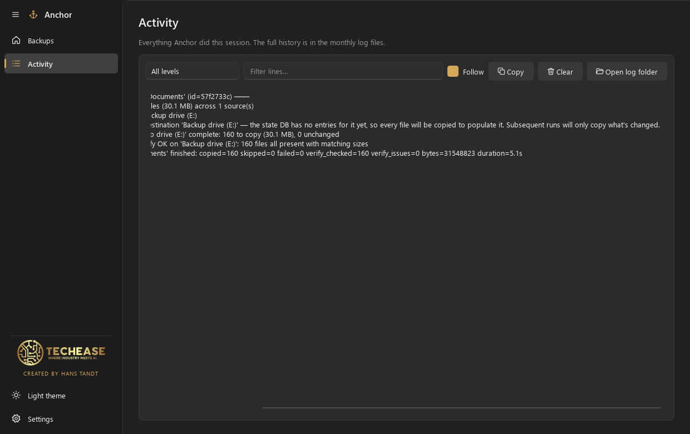

## Settings

| Dark | Light |
|---|---|
| 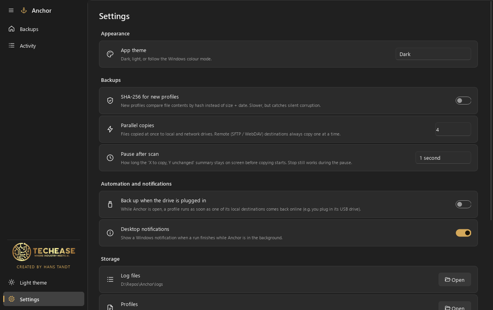 | 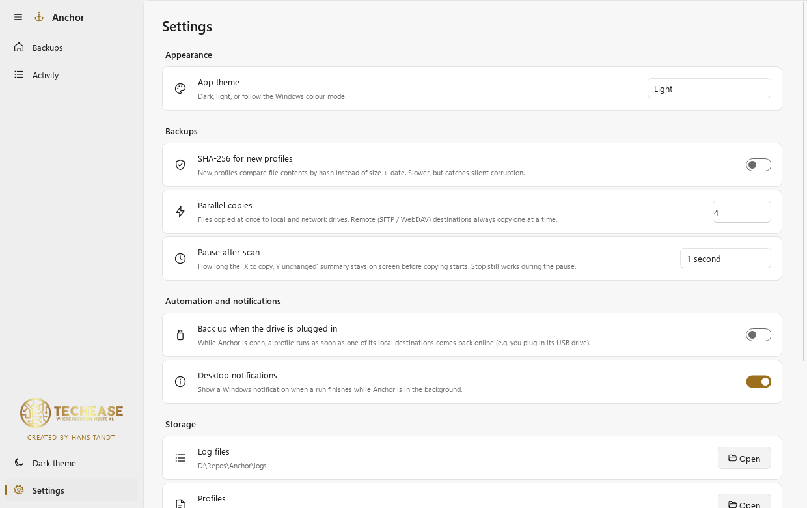 |

## Dialogs

Profile editor (sources, destinations, exclusions, options):

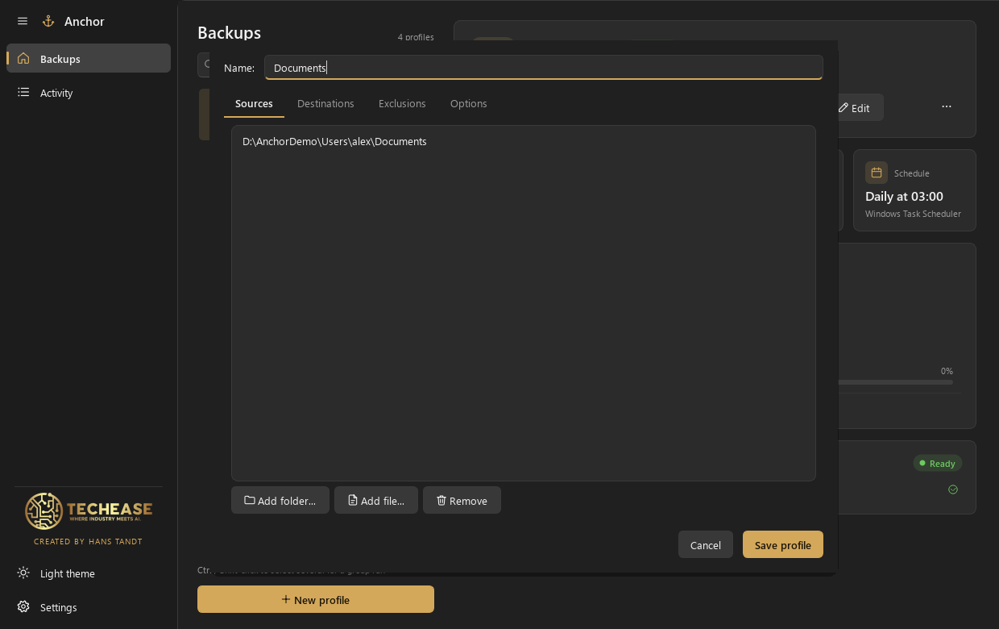

Restore: browse the destination, pick a file and a version:

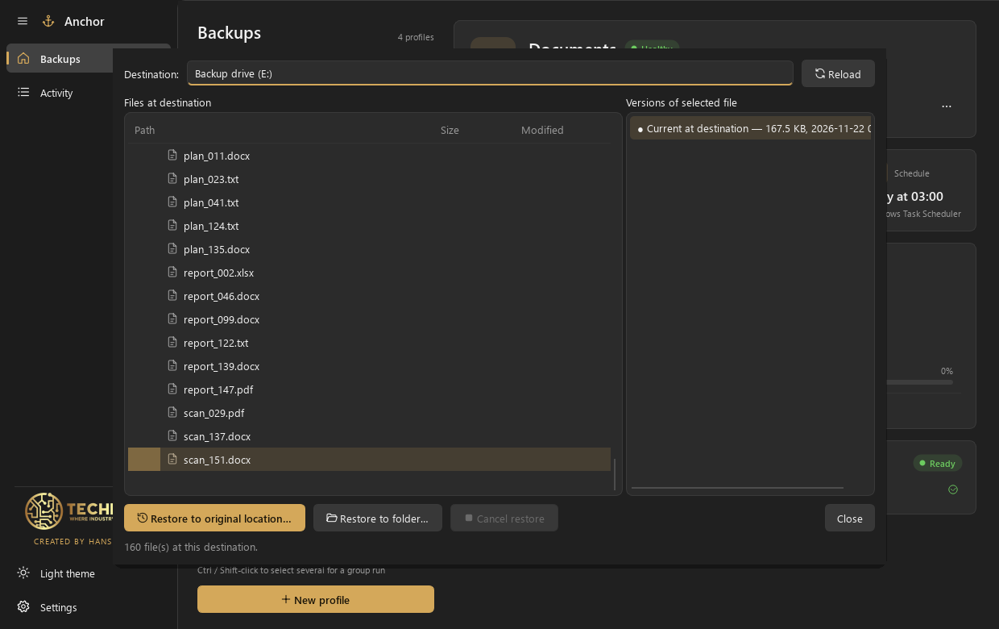

## App icon

| On dark | On light |
|---|---|
| 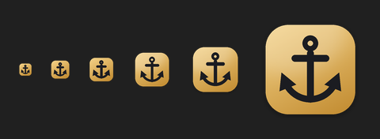 | 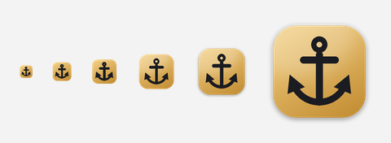 |
